# STOCKSENSE ULTRA PRO — STRATEGIC OPTIMIZATION & SCALING ROADMAP

This roadmap details the remaining gaps, advanced features, and optimizations required to elevate the **Stocksense Ultra Pro** 18-Layer engine into a fully automated, institutional-grade quantitative trading platform. 

---

## 1. System Vulnerability & Optimization Matrix

Below is a diagnostic audit of our current system's bottlenecks and the proposed solutions:

| Component / Layer | Current Bottleneck | Quant-Desk Impact | Institutional-Grade Solution |
| :--- | :--- | :--- | :--- |
| **Layer 17: Backtesting** | Decoupled from live analysis. Computes expectancy on-demand via REST, but main loop returns `null` and relies on mock UI parameters. | High. Traders cannot see the live historical win-rate of the current setup. | **Dynamic Database Backtest Loop**: Query PG `trades` on symbol search; automatically feed results to `tradeExpectancyEngine` for live stats. |
| **Layer 2: Microstructure** | On-demand REST snapshots of order books can lag during high-frequency volatility spikes. | Moderate. OBI (Order Book Imbalance) values might be stale by 1–3 seconds. | **In-Memory Redis WebSocket Cache**: Build a dedicated daemon subscribing to Kite/SmartAPI streams, caching OBI in RAM for instantaneous reads. |
| **Layer 18: Volatility** | ATR Predictor relies on simple rolling indicator maths. | Moderate. Cannot adapt to non-linear regime shifts. | **LSTM / GARCH(1,1) Volatility Predictor**: Deploy a sidecar microservice running Python ONNX models to predict multi-day volatility. |
| **Layer 12: Risk Execution** | Position sizing and stops are calculated but must be copied/executed manually. | Extreme. Slows down execution speed, leading to slippage. | **Automated Broker Brokerage SDK Hooks**: Implement direct bracket order placement (Kite GTT) with calculated SL/Targets. |
| **Layer 7: Derivatives** | Computes PCR and Max Pain but lacks multi-leg derivative structuring. | High. Option traders have to manually construct hedges. | **Automated Options Strategy Recommender**: Generates target spreads (e.g. Bull Call Spread, Iron Condor) based on directional bias. |
| **Layer 15: News & NLP** | News analysis is reactive and triggered on demand. | Moderate. Potential delay in reacting to sudden news. | **Continuous Vector News Ingestion**: Build an RSS and broker-research scraper that populates a Chroma/Pinecone vector database. |

---

## 2. Advanced Architectural Enhancement Blueprints

### A. Real-Time WebSocket Order Book Cache (Layer 2 OBI Caching)

Currently, the order book imbalance is computed by polling quotes. High-frequency setups require **zero-lag** microstructure data. The blueprint below shows the proposed WebSocket cache daemon:

```mermaid
sequenceDiagram
    participant Exchange as NSE / BSE
    participant Stream as Angel One Websocket / Kite API
    participant Daemon as Node.js RAM State Cache (Redis)
    participant Engine as Layer 2 Engine (analyzeStock)

    Note over Daemon: Daemon runs continuously in background
    Stream->>Daemon: Stream ticks & Level-2 order book depth (bid/ask quotes)
    Daemon->>Daemon: Update state cache in RAM (Weighted OBI)
    
    rect rgb(20, 20, 30)
        Note over Engine, Daemon: When trader requests analysis (LTP query)
        Engine->>Daemon: Fetch current OBI & spread (RAM read)
        Daemon-->>Engine: Returns OBI & spread in 0.2ms
    end
```



### B. Dynamic Backtesting Integration (Layer 17 Live Loop)

To make Layer 17 active, we must query historical paper and live trades from our PostgreSQL `trades` table.

```javascript
// PROPOSED IMPLEMENTATION: Injecting this into src/analyze/analyzeStock.js
const { tradeExpectancyEngine, drawdownEngine } = require("../layers/layer17");
const db = require("../db"); // PostgreSQL pool

async function getLiveLayer17Metrics(symbol) {
  try {
    const query = `
      SELECT 
        (exit_price - entry_price) / (entry_price - sl) as r_multiple 
      FROM trades 
      WHERE symbol = $1 AND exit_price IS NOT NULL
      ORDER BY entry_ts DESC LIMIT 100
    `;
    const { rows } = await db.query(query, [symbol]);
    const trades = rows.map(r => ({ r_multiple: parseFloat(r.r_multiple) }));
    
    if (trades.length > 0) {
      const expectancyRes = tradeExpectancyEngine({ trades });
      return {
        ok: true,
        expectancy: expectancyRes.data.expectancy,
        winRate: expectancyRes.data.win_rate,
        totalTrades: expectancyRes.data.total_trades
      };
    }
  } catch (e) {
    console.error("Layer 17 dynamic database loop error:", e);
  }
  return { ok: false, expectancy: 0, winRate: 50, totalTrades: 0 };
}
```

---

## 3. High-Priority Execution Action Plan

> [!IMPORTANT]
> ### ROADMAP TO AUTOMATED QUANT TRADING (V5.0)
> 
> 1. **Phase 1: Real-Time Data Streaming Daemon**
>    - Configure the `smartapi/stream.js` script as a persistent background daemon.
>    - Implement automatic reconnection, token refresh, and memory flushing.
> 
> 2. **Phase 2: Database Bridging**
>    - Bridge the `trades` database table with Layer 17 to display genuine, live expectancy rates and Win-Rates on your frontend dashboard.
> 
> 3. **Phase 3: AI Orchestrator Token & Speed Optimizations**
>    - Implement semantic prompt reduction.
>    - Implement standard caching so identical queries within a 5-minute pre-market window bypass costly LLM runs.
> 
> 4. **Phase 4: Automated Order Execution Pipeline**
>    - Add the **Zerodha Kite Connect / SmartAPI** Order Placement endpoint to Layer 12.
>    - Secure order execution behind a multi-factor authorization switch on the frontend dashboard.

---

## 4. How We Can Build This Right Now

If you want to start building these upgrades, we can proceed step-by-step:
* **Step 1**: Bridge the PG database `trades` query into `analyzeStock.js` to activate **Layer 17** with real backtesting.
* **Step 2**: Implement the continuous WebSocket daemon cache for **Layer 2**.
* **Step 3**: Connect real broker order-execution endpoints to **Layer 12**.

> [!TIP]
> You can use the `/goal` command right now (e.g. `"/goal integrate dynamic database backtesting for Layer 17"`) to command me to begin coding these structural upgrades with deep focus!
